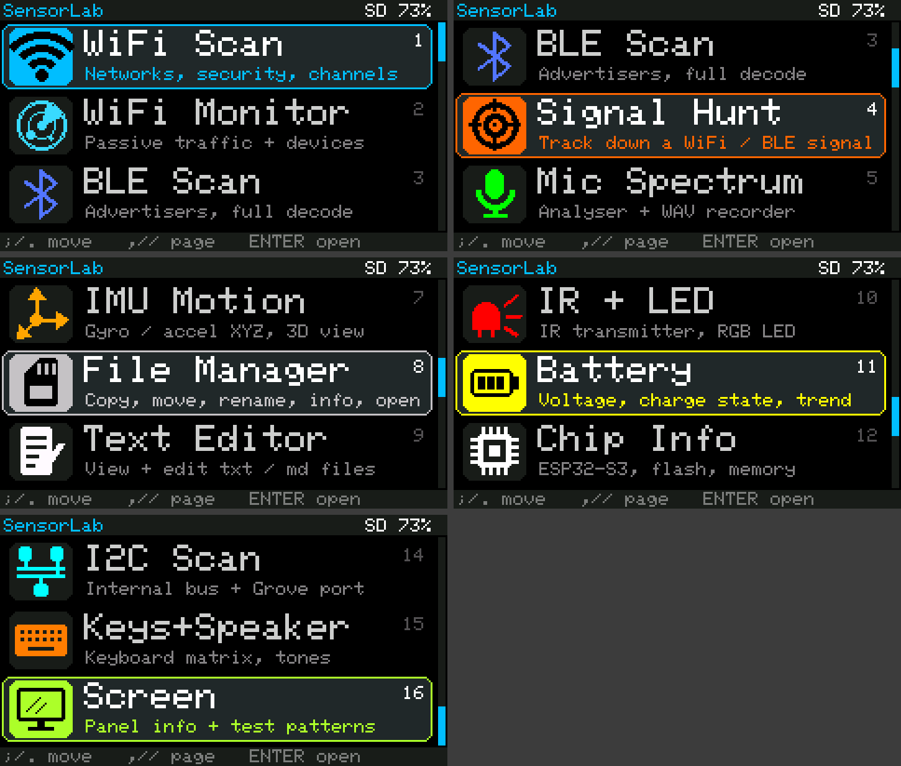

# SensorLab

**A hardware exploration toolkit for the M5Stack Cardputer ADV.**

SensorLab turns the Cardputer ADV into a pocket instrument: it shows what the radios can hear, what
the sensors measure, and what the board itself is made of. It is a single firmware image that
installs from the SD card with [M5Launcher](https://github.com/bmorcelli/Launcher).



- 16 tools: WiFi, Bluetooth LE, audio, motion, files, battery and board diagnostics
- Passive by default: scanning and monitoring only listen. Connecting to a network or a BLE device
  happens only when you ask for it, for equipment you have access to
- Data you capture is saved to the SD card as CSV, WAV or text
- No account, no internet connection, no configuration

## Contents

- [Hardware](#hardware)
- [Install](#install)
- [Controls](#controls)
- [Tools](#tools)
- [Files on the SD card](#files-on-the-sd-card)
- [Hardware limits](#hardware-limits)
- [Build from source](#build-from-source)
- [Responsible use](#responsible-use)
- [Credits and licence](#credits-and-licence)

## Hardware

| | |
|---|---|
| Board | M5Stack **Cardputer ADV** (StampS3A, ESP32-S3, 8 MB flash) |
| Display | 1.14" ST7789V2, 240 x 135 |
| Used by SensorLab | WiFi 2.4 GHz, Bluetooth LE, ES8311 audio codec (mic + speaker), BMI270 IMU, TCA8418 keyboard, IR LED, RGB LED, microSD, battery voltage |
| microSD | Optional, FAT32. Needed for recording, logging, the File Manager, the Text Editor and the Sound Player |

SensorLab is written for the **ADV**. On the original Cardputer it starts and warns that the ADV
was not detected; tools that depend on ADV-only parts (the IMU, the ES8311 codec) will not work.

## Install

### With M5Launcher (recommended)

1. Download `SensorLab-CardputerADV-vX.Y.bin` from the [latest release](https://github.com/RIAL0/SensorLab/releases/latest), or from the [`release`](release) folder.
2. Copy it to the microSD card.
3. Start the Cardputer in Launcher, open **SD**, select the file and choose **Install**.

Launcher's WebUI upload works too. To return to Launcher, reboot and press a key on its start
screen.

### Over USB from source

```bash
pio run -t upload
```

This flashes SensorLab as the only firmware on the device, replacing Launcher.

## Controls

The Cardputer has no arrow keys, so SensorLab uses the four keys that carry the arrow legends.

| Key | Action |
|---|---|
| `;` / `.` | Up / down |
| `,` / `/` | Left / right: previous or next view, page, or field |
| `Enter` | Select, open, start, send |
| `` ` `` (Esc), `Backspace` or the **G0** button | Back |
| `S` | Save the current data to the SD card, on screens that show it in the footer |
| `1` - `9`, `0` | Main menu only: jump to item 1 - 9, or 10 |

The footer of every screen lists the keys that apply there.

Two tools differ, because every key is input for them:

- **Text Editor:** cursor movement needs `Fn` held (see [Text Editor](#9-text-editor)).
- **Keys + Speaker:** only the **G0** button exits.

## Tools

### 1. WiFi Scan

Lists every 2.4 GHz access point in range, including hidden ones. The list is cumulative: SensorLab
scans one channel at a time and merges the results, greying out networks not heard for 15 seconds
and dropping them after 45.

Per network: SSID, BSSID, vendor, channel and frequency, bandwidth, signal in dBm and percent,
estimated distance, authentication mode, pairwise and group cipher, 802.11 b/g/n support, WPS, FTM,
and the country information the access point advertises. A second view charts how many networks sit
on each channel and names the least used one.

| Key | Action |
|---|---|
| `;` `.` | Move through the list |
| `Enter` | Full detail for the selected network |
| `C` or `,` `/` | Switch between the list and the channel chart |
| `P` | Toggle passive scan (listen for beacons only) |
| `A` | Auto-rescan on / off |
| `R` | Rescan now, when auto-rescan is off |
| `X` | Clear the list |
| `S` | Save the list as CSV |
| `J` | Join the selected network (see below) |

**Join a network (`J`).** For a network you have the password for, SensorLab connects and shows what
is visible from the inside. Open networks join without a password; hidden networks ask for the
name. The password is kept in memory until power-off and is never written to the card.

| Option | Shows |
|---|---|
| Connection details | Access point, channel, signal, security, your IP, subnet mask and prefix, network and broadcast addresses, router, DNS servers, MAC, hostname, router radio vendor |
| Connectivity test | Ping to the router, ping to `1.1.1.1`, a DNS lookup of `example.com`, and a verdict on internet access |
| Find devices on this network | Every device that answers an address request: IP, MAC and vendor, with the router and the Cardputer marked. Networks larger than 254 addresses are limited to your own /24 |
| Disconnect | Leaves the network and returns to scanning |

WPA2-Enterprise (username and password) networks are not supported.

### 2. WiFi Monitor

A receive-only view of traffic on the air. One view charts management, data and control frames per
channel; the other lists the devices heard: access points, client stations, which access point a
client is talking to, the network names a client is probing for, signal and frame counts.

| Key | Action |
|---|---|
| `Tab` or `V` | Switch between the channel chart and the device list |
| `H` | Channel hopping on / off |
| `,` `/` | Chart view: pick a channel and stay on it |
| `;` `.` | Device list: move through the list |
| `Enter` | Device list: detail for the selected device |
| `F` | Filter the device list: all, access points, clients |
| `X` | Clear all counters and devices |
| `S` | Save devices and channel counts as CSV |

### 3. BLE Scan

Lists Bluetooth LE devices that are advertising and decodes what they broadcast: name, address and
address type, signal with minimum and maximum, transmit power, path loss, estimated distance,
advertising type, flags, appearance, observed advertising interval, manufacturer and its payload
(with Apple and Microsoft subtypes and iBeacon decoding), advertised services, service data and the
raw bytes. In the list, **C** marks connectable devices and **P** / **R** a public or random address.

**Why many devices have no name.** A phone's Bluetooth list gets most names from Bluetooth Classic,
from devices it has paired with, or by connecting. A BLE scanner only sees what is broadcast, and
many devices (all Apple devices, for privacy) broadcast no name. SensorLab shows the name when
there is one; otherwise it builds the best label it can from the broadcast: the AirPods or Beats
model, a Swift Pair name, the Windows or Xbox device type, a Fast Pair model code, the advertised
service or appearance, or the manufacturer.

| Key | Action |
|---|---|
| `;` `.` | Move through the list |
| `Enter` | Full detail for the selected device |
| `O` | Sort by signal, most recent, or name |
| `P` | Pause / resume scanning |
| `A` | Active / passive scan |
| `X` | Clear the list |
| `S` | Save the list as CSV |
| `F` | Filter: all, my tags, near (stronger than -60 dBm), named, no Apple, connectable |
| `T` | Tag the selected device with your own name |
| `G` | Connect to the selected device and read it (see below) |

**Finding your own device in a crowd.** Hold it next to the Cardputer and press `F` for the *near*
filter, or use *no Apple* to hide the usual crowd of phones and earbuds. Then tag it with `T`, or
connect with `G`: a successful connection labels the device with the name and model it reports.
Your own tags are marked `*` and labels learned by connecting are marked `+`; both also appear in
Signal Hunt. The *my tags* filter shows only the devices you named yourself, and *no Apple* hides
every Apple device except those. Devices with a fixed address are
remembered in `/SensorLab/ble_names.csv`; phones and earbuds rotate their address every 15 minutes
or so, and their tag lasts only until that happens.

**Connect and read (`G`).** SensorLab connects to the selected device, lists its services and
characteristics, reads every value the device allows (name, model, serial, firmware and hardware
revision, manufacturer, battery level and anything else readable), then disconnects. Choose
"Pair with passkey" for devices that protect their values behind a fixed 6-digit code. Devices that
show a new random code on their own screen while pairing are not supported, and Apple devices
generally refuse.

### 4. Signal Hunt

A fox hunt for one transmitter. Pick a WiFi access point or a BLE device from a live list, lock on,
and walk: the screen shows a large signal reading, a warmer / colder indicator, a strength bar with
a peak marker and the last minute as a graph, while Geiger-style clicks speed up and rise in pitch
as you get closer.

| Screen | Key | Action |
|---|---|---|
| Target list | `;` `.` | Move through the list |
| Target list | `Tab` or `,` `/` | Switch between WiFi networks and BLE devices |
| Target list | `Enter` | Lock on to the selected target |
| Target list | `F` | BLE list filter: all, my tags, near, named, no Apple |
| Target list | `X` | Clear the list |
| Target list | `M` | Sound on / off |
| Tracking | `M` or `Space` | Sound on / off |
| Tracking | `;` `.` | Volume up / down |
| Tracking | `0` | Reset the peak marker |
| Tracking | `` ` `` | Back to the target list |

The antenna is not directional: the tool tells you stronger or weaker, not which way. BLE devices
that rotate their address (most phones and earbuds) are lost when the address changes and have to
be picked again.

### 5. Mic Spectrum

A 1024-point spectrum analyser at 16 kHz with three views: log-frequency bars with peak hold, a
scrolling spectrogram, and an oscilloscope. It shows the peak frequency and level, the RMS level in
dBFS and a clipping warning, and records 16 kHz mono 16-bit WAV files.

| Key | Action |
|---|---|
| `,` `/` or `V` | Next / previous view |
| `;` `.` | Microphone gain up / down (0 to +30 dB in the codec, +24 dB by default) |
| `Enter` or `R` | Start / stop recording to the SD card |
| `H` | Freeze / resume the display |

### 6. Sound Player

Plays WAV files from the SD card: uncompressed PCM, 8 or 16 bit, mono or stereo, any sample rate.
It opens in `/SensorLab`, where Mic Spectrum saves its recordings.

| Screen | Key | Action |
|---|---|---|
| File list | `;` `.` | Move through the list |
| File list | `Enter` | Play the file, or open the folder |
| File list | `,` | Up one folder |
| File list | `D` | Delete the file (asks first) |
| File list | `A` | Auto-next: continue through the folder |
| Playing | `Space` or `Enter` | Pause / resume |
| Playing | `,` `/` | Seek 5 seconds back / forward |
| Playing | `;` `.` | Volume up / down |
| Playing | `G` | Gain: auto, x1, x2, x4, x8 |
| Playing | `` ` `` | Stop |

Gain is automatic by default: the file is checked first and quiet recordings are raised to full
level, up to 16 times.

### 7. IMU Motion

Live accelerometer and gyroscope data from the BMI270 in three views: a 3D box that follows the
device with roll, pitch, yaw and a bubble level; bar meters for each axis; and rolling graphs.

| Key | Action |
|---|---|
| `,` `/` or `V` | Next / previous view |
| `C` | Calibrate the gyroscope (hold the device still) |
| `0` | Zero the yaw angle and the peak acceleration |
| `S` | Start / stop logging to CSV |

### 8. File Manager

A file manager for the microSD card. Folders and files have distinct icons, coloured by type.
Opening a file picks the right tool: WAV files play, text files open in the editor, anything else
is shown as a hex dump.

| Key | Action |
|---|---|
| `;` `.` | Move through the list; it wraps, so up from the first item jumps to the last |
| `Enter` | Open the file or folder |
| `,` or `` ` `` | Up one folder |
| `Tab` or `M` | Action menu with everything below |
| `C` / `X` / `V` | Copy / cut / paste here |
| `R` | Rename |
| `N` | New folder |
| `T` | New text file |
| `D` | Delete (asks first; folders are deleted with their contents) |
| `I` | Information about the selected item |
| `H` | Hex view |
| `S` | SD card report |

Pasting where the name already exists creates `name_copy.ext`; nothing is overwritten. The SD card
report covers the card type and capacity, the maker, product name, serial number and manufacture
date read from the card, the filesystem format and cluster size, and used and free space.

### 9. Text Editor

Views and edits plain-text files (`.txt`, `.md`, `.csv`, `.json`, `.conf` and similar) up to 48 KB,
with light colouring for Markdown headings, lists and quotes. Start it from the menu for a new note
or a file chooser, or open a text file from the File Manager.

Because `;` `.` `,` `/` have to type as ordinary characters here, cursor keys need a modifier.

| Key | Action |
|---|---|
| `Fn` + `;` `.` `,` `/` | Move the cursor up, down, left, right |
| `Ctrl` + `;` `.` | Page up / down |
| `Ctrl` + `,` `/` | Start / end of the line |
| `Enter` | New line |
| `Backspace` | Delete the character before the cursor |
| `Tab` | Insert two spaces |
| `Ctrl` + `K` | Delete the current line |
| `Ctrl` + `S` | Save |
| `Ctrl` + `Q`, `Fn` + `` ` `` or the **G0** button | Quit; asks to save, discard or keep editing |

Long lines scroll sideways. Files over 48 KB open read-only and show the first part.

### 10. IR + LED

Sends a test infrared frame and cycles the RGB LED. A phone camera shows the IR LED flashing.

| Key | Action |
|---|---|
| `P` | Protocol: NEC, Samsung, Sony 12-bit, RC5 |
| `,` `/` or `Tab` | Select the address or the command field |
| `;` `.` | Change the selected value |
| `Enter` or `Space` | Send |
| `L` | RGB LED: off, red, green, blue, white |

### 11. Battery

Cell voltage, percentage, a charging / on battery / full indicator, minimum and maximum, the trend
in mV per minute, an estimate of time left, and a 16-minute graph.

| Key | Action |
|---|---|
| `S` | Start / stop logging to CSV |

### 12. Chip Info

A scrollable report on the ESP32-S3: board detected, uptime, last reset reason, chip model and
revision, cores, clocks, die temperature, radios, heap and PSRAM, flash size, ID, speed and mode,
app size and slot usage, the partition table, MAC addresses and software versions.

| Key | Action |
|---|---|
| `;` `.` | Scroll |
| `,` `/` | Page up / down |
| `S` | Save the report as text |

### 13. GPIO Pins

Every ESP32-S3 pin with its job on the Cardputer ADV, whether it is brought out to a connector, and
its live state: level, direction (input, output, open-drain), pulls, and ADC, touch, RTC or
strapping capability.

| Key | Action |
|---|---|
| `;` `.` | Move through the list |
| `,` `/` | Page up / down |
| `F` or `Tab` | Filter: all, exposed, internal, unused |
| `S` | Save the table as CSV text |

### 14. I2C Scan

Scans the internal I2C bus and the Grove port every 3 seconds and names what answers. On the ADV
the internal bus holds the audio codec (0x18), the keyboard controller (0x34) and the IMU (0x69).

| Key | Action |
|---|---|
| `;` `.` | Scroll |
| `S` | Save the result as text |

### 15. Keys + Speaker

Shows the key matrix live, the modifier keys, HID codes and matrix coordinates, and plays a tone
for every key.

| Key | Action |
|---|---|
| any key | Shown on the matrix, with its tone |
| `Ctrl` | Sound on / off |
| `Opt` | Volume |
| **G0** button | Exit |

### 16. Screen

Panel information and test patterns: colour bars, gradients, solid white, red and black for dead
pixel checks, a pixel grid, and a full-screen animation that measures the real frame rate.

| Key | Action |
|---|---|
| `,` `/`, `Enter` or `Space` | Next / previous pattern |
| `;` `.` | Backlight brightness |

## Files on the SD card

SensorLab keeps everything it writes in `/SensorLab/`, numbered in sequence.

| File | Written by |
|---|---|
| `rec_NNNN.wav` | Mic Spectrum recordings |
| `wifi_NNNN.csv` | WiFi Scan |
| `wifimon_NNNN.csv` | WiFi Monitor |
| `ble_NNNN.csv` | BLE Scan |
| `imu_NNNN.csv` | IMU Motion log |
| `batt_NNNN.csv` | Battery log |
| `note_NNNN.txt` | Text Editor new notes |
| `ble_names.csv` | Your BLE device tags |
| `chip_`, `pins_`, `i2c_`, `sdcard_`, `wifi_ap_`, `wifi_dev_`, `ble_dev_`, `ble_gatt_`, `netinfo_`, `netdevices_NNNN.txt` | Saved reports and detail pages |

**Vendor names:** a small table of network-card vendors is built in. For full coverage, add
`/SensorLab/oui.csv` with one `AABBCC,Vendor name` line per vendor prefix.

## Hardware limits

- **WiFi is 2.4 GHz only.** The ESP32-S3 cannot see 5 GHz or 6 GHz networks.
- **No battery fuel gauge.** The ADV exposes only the cell voltage, so the percentage, trend and
  time left are estimates from voltage. The charging indicator is certain when a USB host
  (computer) is connected and inferred from the voltage when a plain charger is used, which can
  take around 30 seconds to settle.
- **Microphone and speaker share one audio bus**, so the speaker is silent while Mic Spectrum is
  open.
- **Distances are rough.** Every distance shown is an order-of-magnitude estimate from signal
  strength.
- **File dates.** The Cardputer has no real-time clock, so files SensorLab creates carry no
  meaningful date.
- **SD card report.** Speed class, volume label and wear data are not available.
- **Expansion header labels.** Internal pin assignments come from M5Stack's libraries. The labels
  for the 14-pin EXT header in the GPIO tool should be checked against the board's silkscreen
  before wiring anything to those pins.

## Build from source

SensorLab is a [PlatformIO](https://platformio.org/) project using the Arduino framework.

```bash
pip install platformio
```

```bash
pio run
```

The image is written to `.pio/build/cardputer-adv/firmware.bin`. Every push is also built by the
workflow in [`.github/workflows/build.yml`](.github/workflows/build.yml). To publish a GitHub
release, run that workflow from the Actions tab with a version such as `v1.8`, or push a `v*` tag.

### Project layout

| Path | Contents |
|---|---|
| `src/main.cpp` | Start-up and the main menu loop |
| `src/menu_draw.h` | Menu items, order and icons |
| `src/ui.h`, `src/ui.cpp` | Shared screen, keyboard, dialog and SD card helpers |
| `src/app_*.cpp` | One file per tool or group of tools (`app_net.cpp` is the WiFi join feature) |
| `preview/preview.cpp` | Renders the main menu on a PC with the same drawing code (needs SDL2) |
| `release/` | Ready-to-install firmware image |

To add a tool: write `void appMyTool()` in a new `src/app_*.cpp`, declare it in `src/apps.h`, add a
row to `MENU_ITEMS` in `src/menu_draw.h` and the function to `RUN` in `src/main.cpp` at the same
position.

## Responsible use

Scanning, monitoring and Signal Hunt only listen. They transmit nothing beyond the ordinary probe
and scan requests every phone sends when it lists nearby networks and devices, and SensorLab has no
tools to capture credentials, break passwords or disrupt a network.

Two actions do connect, and only when you start them: joining a WiFi network with its password
(`J` in WiFi Scan) and connecting to a BLE device to read it (`G` in BLE Scan). Use them on networks
and devices that are yours or that you have permission to examine. Listing the devices on a network
you do not administer, or connecting to someone else's device, may be unlawful where you are.

Radio monitoring is regulated differently from country to country, and the names and addresses of
nearby devices can be personal data. Follow the law where you are.

## Credits and licence

SensorLab is released under the [MIT licence](LICENSE).

It builds on these open-source projects:

- [M5Unified](https://github.com/m5stack/M5Unified), [M5GFX](https://github.com/m5stack/M5GFX) and [M5Cardputer](https://github.com/m5stack/M5Cardputer) by M5Stack (MIT)
- [NimBLE-Arduino](https://github.com/h2zero/NimBLE-Arduino) by h2zero (Apache 2.0)
- [Arduino-IRremote](https://github.com/Arduino-IRremote/Arduino-IRremote) (MIT)
- [Arduino core for ESP32](https://github.com/espressif/arduino-esp32) by Espressif (LGPL 2.1)
- [M5Launcher](https://github.com/bmorcelli/Launcher) by bmorcelli, used to install it

SensorLab is an independent project and is not affiliated with or endorsed by M5Stack.

See the [changelog](CHANGELOG.md) for the release history.
